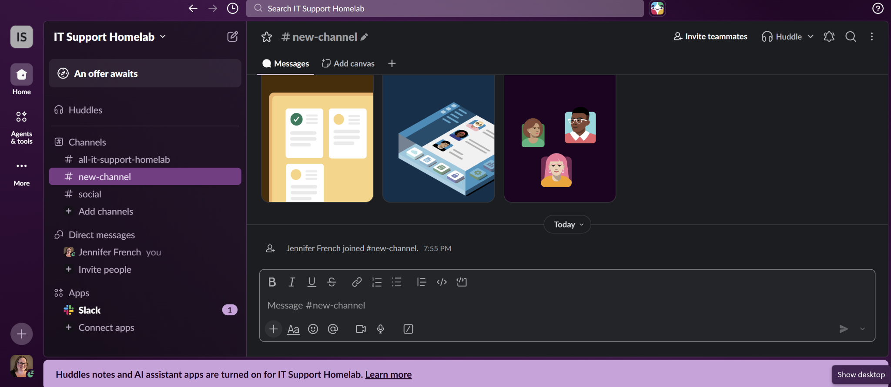
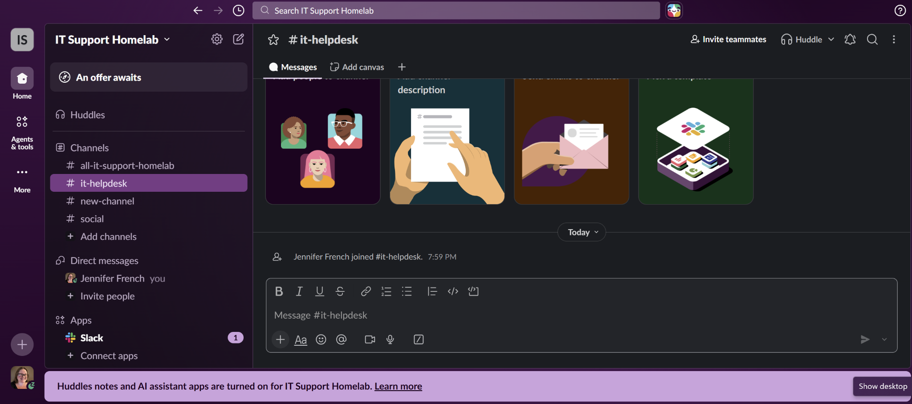
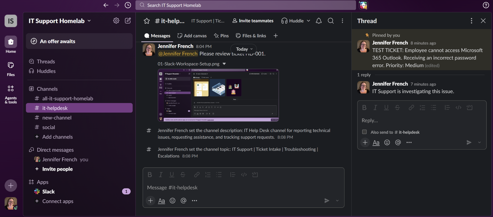
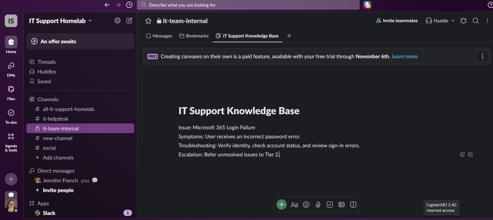
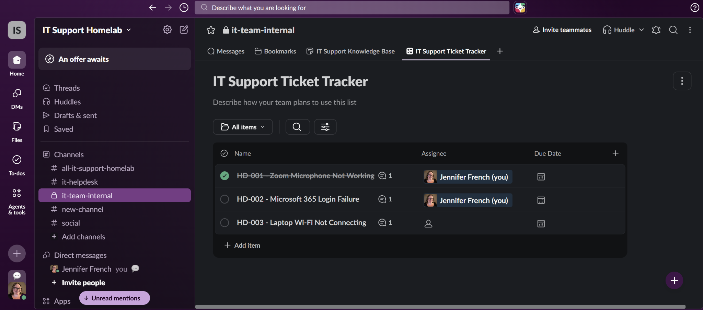
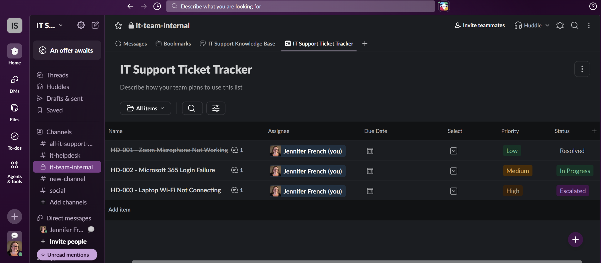

# Slack IT Help Desk Lab

## Overview

I created this lab to get more hands-on experience with Slack and how it's used in an IT support environment.

I've worked with Microsoft Teams and Discord before, but I wanted to get familiar with Slack from both a user and an IT support perspective.

For this lab, I created a practice workspace, set up support channels, worked with messages and notifications, and built a basic ticket tracker. I also practiced documenting technical issues and communicating updates.

Everything was completed in my own practice environment using simulated IT support requests.

## Lab Environment

**Platform:** Slack  
**Operating System:** Windows 11  
**Workspace:** IT Support Homelab  
**Channels:** #it-helpdesk and #it-team-internal  
**Tools:** Slack Channels, Huddles, Canvas, Lists, and Search

## 1. Workspace Setup

I started by creating a Slack workspace called IT Support Homelab.

This gave me a place to practice managing channels, messages, and support requests without affecting a real company's environment.

## 2. IT Help Desk Channel

I created a public channel called #it-helpdesk to simulate a place where employees could report technical problems.

I also added a channel description and topic to make its purpose clear.

## 3. Messaging and Support Communication

I created a test support request involving an employee who couldn't sign into Microsoft 365 Outlook.

I practiced replying in threads, editing messages, using mentions, pinning important information, and sharing files.

I also explored Slack's search tools, including searching by channel, sender, and specific phrases.

## 4. Private Channels and Team Collaboration

I created a private channel called #it-team-internal to practice separating internal IT discussions from general employee support requests.

I verified the channel's privacy settings and added an internal troubleshooting update.

I also practiced direct messages, message reminders, saved messages, status settings, and notification controls.

## 5. Slack Huddles and Screen Sharing

I started a Slack Huddle and practiced using the microphone controls.

I explored the different screen-sharing options, including sharing a browser tab, an application window, or an entire screen.

I also practiced starting and stopping screen sharing and leaving the Huddle.

## 6. IT Support Knowledge Base

I created a Slack Canvas called IT Support Knowledge Base.

For my first article, I documented a simulated Microsoft 365 login problem, including the symptoms, initial troubleshooting steps, and when to escalate the issue.

The goal was to practice writing documentation that another support technician could easily understand and use.

## 7. IT Support Ticket Tracker

I created an IT Support Ticket Tracker using Slack Lists.

I added three simulated support tickets involving:

- Microsoft 365 login failure
- Zoom microphone troubleshooting
- Laptop Wi-Fi connectivity

I practiced adding comments, documenting troubleshooting updates, closing a resolved ticket, and recording an escalation.

## 8. Ticket Priorities and Statuses

I added custom fields to track ticket priorities and statuses.

The priorities included Low, Medium, High, and Critical.

The statuses included Open, In Progress, Escalated, and Resolved.

I assigned priorities and statuses to the practice tickets and used filtering to find high-priority requests.

This helped me understand how a support team can organize multiple open issues and keep track of what needs attention.

## 9. What I Learned

This lab helped me become more comfortable navigating Slack and understanding how it can support an IT help desk.

I practiced organizing support requests, communicating through channels and threads, documenting troubleshooting steps, and tracking ticket progress.

I also learned how Slack's collaboration tools can help keep technical discussions organized.

One important distinction is that this was a Slack practice lab, not a production ticketing environment. I used Slack Lists to simulate ticket management rather than working directly in a dedicated ticketing platform.

## 10. Next Steps

I plan to continue building on this lab by learning Foqal, a ticketing platform that integrates with Slack.

My next goal is to practice ticket intake, triage, assignments, troubleshooting documentation, and escalation using a dedicated help desk system.

I'll continue documenting my hands-on IT labs here on GitHub as I work through additional technologies.

---

**Lab Type:** Hands-on practice  
**Environment:** Personal Slack workspace  
**Experience Level:** Foundational IT Support  
**Status:** Completed
